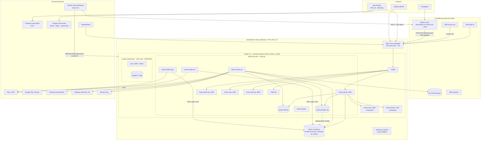

# Infraestructura de Kuulis (mapa completo)

Todo lo que Kuulis usa, dónde vive, qué hace, cómo se despliega y qué hace Carlos a mano. Revisado contra la API
de Coolify y la de Cloudflare (solo lectura) el **2026-10-24**. Lo que tiene proveedor de Terraform está en
[`infra/terraform/`](../../infra/terraform/README.md); lo demás está aquí y en
[servicios-externos.md](servicios-externos.md).

- Runbooks del día a día (variables, encender producción, backups, rollback, OTA): [`docs/deployment.md`](../deployment.md).
- Secretos: solo **nombres** en este documento. Los valores están en Coolify, en la cuenta de cada servicio o en
  el gestor de contraseñas de Carlos.

## Diagrama

## Ruta de una petición

`App o navegador → Cloudflare DNS (comodín *.top8.uk, nube naranja) → Nginx Proxy Manager en casa (TLS, Websockets)
→ Traefik de Coolify (enruta por dominio; /api a la API) → contenedor`. Traefik confía en NPM
(`forwardedHeaders.trustedIPs=192.168.0.148/32` en la configuración del proxy del servidor `localhost`) para que la
API vea la IP real. La web pública de `kuulis.com` es la excepción: la sirve el Worker de Cloudflare y llama a la
API por HTTPS (hoy la de QA).

## Coolify

Proyecto **kuulis** (`cexs6860hwyfto1mwzjrsflw`). Fuente: GitHub App privada de Carlos
(`zkc08c4skokc4g80kww8oooc`) sobre `carlozrodri/kuulis`. Todas las apps usan build pack **Dockerfile** con
`base_directory` y `watch_paths`; auto-deploy = cada push a la rama que toca su carpeta.

### Entorno `qa-env` (rama `qa`)

| App | uuid | Dominio(s) | Carpeta · Dockerfile | watch_paths | Para qué |
| --- | --- | --- | --- | --- | --- |
| `kuulis-api-qa` | `rayxgnveijwwq86tquloc3r8` | `kuulis-qa.top8.uk/api`, `admin.top8.uk/api`, `kuulis.top8.uk/api` | `/api` · `/Dockerfile` | `api/**` | API FastAPI (REST + WebSocket), migra al arrancar, health `/health/live` |
| `kuulis-worker-qa` | `i10vqipywxmdafk5sjaowzya` | (autogenerado, sin uso) | `/api` · `/Dockerfile` | `api/**` | Taskiq: despacho, cuotas, Binance, push, alertas, backups a R2 |
| `kuulis-admin-qa` | `m37iqum9dy4n0o5281n0tvu5` | `kuulis-qa.top8.uk`, `admin.top8.uk` | `/admin` · `/Dockerfile` | `admin/**` | Panel Nuxt del equipo (2FA) |
| `Kuulis web` | `p4lpainpky5a5tf5oe9ggthm` | `kuulis.top8.uk`, `www.kuulis.top8.uk` | `/web` · `/Dockerfile` | *(ninguno)* | Web pública de QA (enlaces de email, `/v/{token}`) |
| `kuulis-expo-qa` | `d2gt6a6g8uan4kwghzrti478` | `kuulis-expo.top8.uk` | `/mobile` · `/Dockerfile.expo` | `mobile/**` | Servidor de Expo para Expo Go y el build `qa-dev` |
| `kuulis-builder-qa` | `txv8ffisp3r31rw819bjnxtk` | — | `/mobile` · `/builder/Dockerfile` | `mobile/**` | Compila APK de QA o exporta OTA; sube a S3 `builds/qa/` |
| `kuulis-builder-play` | `77tord3ekdodttbsa7w04pfu` | — | `/mobile` · `/builder/Dockerfile` | `mobile/**` | Compila el `.aab` de Play (`com.kuulis.app`) a `builds/play/` |
| `kuulis-osrm` | `nqbbvoaqqvzkthxeq6vts7zc` | — (alias `kuulis-osrm`) | `/infra/osrm` | `infra/osrm/**` | Rutas y tiempos (compartido QA y prod), 1,5 GB máx. |
| `kuulis-photon` | `owcfbizidzhgftvwksyxqkis` | — (alias `kuulis-photon`) | `/infra/photon` | `infra/photon/**` | Búsqueda de direcciones (compartido), 1 GB máx. |
| `kuulis-loadtest` | `c86tdf34xkaz27ih1brik5ji` | `kuulis-carga.top8.uk` | `/loadtest` | `loadtest/**` | Generador de carga k6 (doc 18), en el servidor **pc grande**; parado |

| Base o servicio | uuid | Detalle |
| --- | --- | --- |
| `kuulis-postgres-qa` | `v12h71ber6ifhpgcugm6adth` | `postgres:17-alpine`, db/usuario `kuulis`, 1,5 GB, `postgresql.conf` propio, **puerto público 3333** |
| `kuulis-redis-qa` | `miq3v8c99isk848ps719a7dn` | `redis:7.4-alpine`, 768 MB, AOF + `noeviction` |
| Backup Coolify de Postgres QA | id 4 | diario 03:00, 7 días local, sube al MinIO (falla, ver hallazgos) |
| `GlitchTip` (servicio) | `ltics19o8wipo8ri1sxrkpog` | errores en `glitchtip.top8.uk` (dominio con `:8000` en Coolify) |
| `kuulis-node-exporter` (servicio) | `adcd9mh42gvr11furlabnsl0` | métricas del servidor para pruebas de carga |

### Entorno `production` (rama `main`) — apagado desde 2026-10-09

| Recurso | uuid | Estado |
| --- | --- | --- |
| `kuulis-api-production` | `f14idkxf8c209b1hghrunmhb` | parado, auto-deploy off, `kuulis-prod.top8.uk/api` |
| `kuulis-worker-production` | `f3eiht6l1r439xxp3401u2ur` | parado, auto-deploy off |
| `kuulis-admin-production` | `ru2e54bw4mn4igqvvdmkgrys` | parado, auto-deploy off, `kuulis-prod.top8.uk` |
| `kuulis-postgres-production` | `pvx2gkfbo18zcld9x55t0tgp` | parado; backup Coolify cada 6 h, 14 días, **desactivado** |
| `kuulis-redis-production` | `mgtsa16kwmktv0jl55belww8` | parado, sin `redis.conf` propio todavía |

Plan decidido (2026-10-21): producción irá en un **VPS** añadido como servidor remoto a este Coolify (Postgres,
Redis, API, worker, OSRM, Photon), con DNS de Cloudflare apuntando directo al VPS sin NPM; el admin pasará a
Cloudflare con Access. Nada de eso existe aún.

### Volúmenes

| App | Montaje | Para qué |
| --- | --- | --- |
| `kuulis-builder-qa` | `/cache` | Caché de Gradle y npm (evita recompilar) |
| `kuulis-builder-play` | `/cache` | Igual, separado del de QA |

Postgres y Redis usan los volúmenes de datos que crea Coolify para cada base.

### Variables de entorno (solo nombres)

`terraform output coolify_applications` las lista por app. Resumen:

| App | Variables |
| --- | --- |
| API QA | `APP_ENV`, `PROCESS_TYPE`, `SECRET_KEY`, `DATABASE_URL`, `REDIS_URL`, `RUN_MIGRATIONS`, `WEB_CONCURRENCY`, `AWS_ACCESS_KEY_ID`, `AWS_SECRET_ACCESS_KEY`, `AWS_S3_BUCKET`, `AWS_S3_ENDPOINT`, `STORAGE_PREFIX`, `EMAIL_ENABLED`, `EMAIL_FROM`, `RESEND_API_KEY`, `FRONTEND_URL`, `PUBLIC_URL`, `CORS_ORIGINS`, `FIRST_SUPERUSER_EMAIL`, `FIRST_SUPERUSER_PASSWORD`, `OSRM_URL`, `PHOTON_URL`, `SENTRY_ENABLED`, `SENTRY_DSN`, `ALERT_TELEGRAM_BOT_TOKEN`, `BINANCE_API_KEY`, `BINANCE_API_SECRET`, `GOOGLE_CLIENT_IDS`, `APPLE_CLIENT_IDS`, `UPDATES_SIGNING_KEY`, `MARKETING_S3_ACCESS_KEY_ID`, `MARKETING_S3_SECRET_ACCESS_KEY`, `MARKETING_S3_BUCKET`, `SMOKE_ADMIN_EMAIL`, `SMOKE_ADMIN_PASSWORD`, `SMOKE_ADMIN_TOTP_SECRET`, `LOG_FORWARDED_FOR` |
| Worker QA | las comunes de la API más `WORKER_CONCURRENCY`, `DB_POOL_SIZE`, `DB_MAX_OVERFLOW`, `BACKUP_ENABLED`, `BACKUP_PASSPHRASE`, `BACKUP_S3_ENDPOINT`, `BACKUP_S3_BUCKET`, `BACKUP_S3_ACCESS_KEY_ID`, `BACKUP_S3_SECRET_ACCESS_KEY` (sin `FIRST_SUPERUSER_*`, `UPDATES_SIGNING_KEY`, `MARKETING_*`, `SMOKE_*`) |
| Admin (QA y prod) | `NUXT_PUBLIC_API_BASE`, `NUXT_PUBLIC_APP_ENV` |
| Web QA (Coolify) | `NUXT_PUBLIC_APP_ENV`, `NUXT_PUBLIC_SITE_URL` |
| Expo QA | `EXPO_OWNER`, `EXPO_TOKEN` |
| Builder QA | `EXPO_OWNER`, `EXPO_TOKEN`, `AWS_*` |
| Builder Play | `APP_ENV`, `BUILD_PROFILE`, `BUILD_NONCE`, `EXPO_OWNER`, `EXPO_TOKEN`, `GOOGLE_PLAY_SERVICE_ACCOUNT_JSON`, `AWS_*` |
| Loadtest | `BASE_URL`, `TARGET_IP`, `NODE_CPUS`, `NODE_EXPORTER_URL`, `PUSH_LATENCY_MS`, `RUNNER_TOKEN`, `LOADTEST_PASSWORD` |
| API / worker producción | solo las comunes de 2026-10-09; faltan las añadidas después (OSRM, Photon, Sentry, Telegram, Google/Apple, OTA, backups…). Ver «Encender producción» en `deployment.md` |

### Servidores de Coolify

| Servidor | uuid | IP | Kuulis |
| --- | --- | --- | --- |
| `localhost` | `rgs440ogg84kwcowo88cwkg8` | host del propio Coolify | todo menos el loadtest; comodín de dominios `https://top8.uk` |
| `pc grande` | `dvartdzch1ddpiyfpizhqwvj` | 192.168.0.30 | `kuulis-loadtest` |
| `node-1` | `e105cvf7llmr13mtdhvzbdcw` | 192.168.0.68 | nada |

Compartidos con otros proyectos de Carlos: Terraform solo los lee. Los proyectos **NDS** y **bidding-market** no
se tocan.

## Cloudflare

Cuenta `1e6a34cfe895e17e830e8d7824b429b2` (plan gratis en ambas zonas).

| Qué | Detalle | En Terraform |
| --- | --- | --- |
| Zona `kuulis.com` | DNS de Cloudflare (registrador IONOS) | sí |
| `kuulis.com`, `www.kuulis.com` | Dominios personalizados del Worker `kuulis` (crean los AAAA `100::` de solo lectura) | sí |
| `*.kuulis.com` | A → 81.202.2.12 (homelab), naranja | sí |
| Correo `@kuulis.com` | MX `mx00/mx01.ionos.es`, SPF IONOS, `_dmarc`, `autodiscover`, `_domainconnect` | sí |
| Zona `top8.uk` | Dominio personal; Kuulis usa el comodín `*.top8.uk` → 81.202.2.12 (naranja) y el correo de Resend | solo los 3 registros de Resend; el comodín con `manage_shared_dns` |
| Worker `kuulis` | Web pública (`web/`, `wrangler.jsonc`), observabilidad y logs activos, variables `NUXT_API_INTERNAL`, `NUXT_PUBLIC_API_BASE`, `NUXT_PUBLIC_APP_ENV`, `NUXT_PUBLIC_SITE_URL` en el panel | no (lo despliega Workers Builds desde la rama `qa`, carpeta `web/`) |
| R2 `kuulis-backups` | Backups cifrados del worker. Reglas: `qa/postgres/recent/` 2 días, `qa/postgres/daily/` 14 días, `qa/ledger/` 90 días, multipart 7 días | bucket sí; reglas con `manage_r2_lifecycle` |
| Web Analytics | sitio de `kuulis.com` (auto-instalado) y otro de `top8.uk` | el de `kuulis.com` |
| Seguridad | Reglas gestionadas gratis (Free Managed, DDoS L7, normalización). Sin reglas WAF propias, sin page rules, sin Turnstile, sin Access | ajustes de zona sí; reglas gestionadas no hace falta |
| Túnel `home` | Inactivo desde que se creó (2026-04), no lo usa Kuulis | no |

## Despliegue (resumen)

| Pieza | Cómo se despliega | Quién |
| --- | --- | --- |
| API, worker, admin, web QA, Expo, OSRM, Photon, builders | Push a `qa` (o `main`) → webhook de la GitHub App → Coolify construye la carpeta que cambió | automático tras el merge |
| Web pública `kuulis.com` | Workers Builds en cada push a `qa` (`pnpm build:cloudflare` + `npx wrangler deploy`) | automático |
| APK de QA / OTA | `kuulis-builder-qa` al cambiar `mobile/**`; se publica desde el admin (Versiones) | Carlos publica |
| AAB de Play | `kuulis-builder-play`; se sube a mano en Play Console (Prueba cerrada) | Carlos |
| CI | GitHub Actions `.github/workflows/ci.yml` (check `ci`) en cada PR | automático |
| Mapas de OSRM/Photon | Redeploy manual al mes (los datos se bajan al construir) | Carlos |

## Lo que Carlos hace a mano

- **Nginx Proxy Manager**: crear un proxy host por dominio (con Websockets) hacia Traefik; certificados.
- **Coolify UI**: crear apps nuevas, poner y rotar valores de variables, `postgresql.conf`/`redis.conf`, S3 de los
  backups de Coolify, ajustes avanzados (destinos internos permitidos), arrancar o parar producción.
- **Cloudflare panel**: DNS nuevos, variables del Worker, Workers Builds, R2 (bucket, reglas, tokens), Analytics.
- **Expo / EAS**: variables de los entornos de EAS, keystores, rotar `EXPO_TOKEN`.
- **Google**: OAuth y Maps en Google Cloud, Firebase, Play Console (versiones, testers, fichas), claves de la
  cuenta de servicio.
- **Resend, Telegram, UptimeRobot, Binance, IONOS**: cuentas y claves.
- **GitHub**: protección de ramas, GitHub App de Coolify.

Detalle de cada servicio externo: [servicios-externos.md](servicios-externos.md).

## Hallazgos de la revisión (2026-10-24)

Nada de esto se cambió; queda para que Carlos decida.

1. **Postgres de QA expuesto**: `kuulis-postgres-qa` tiene `is_public` con el puerto 3333 abierto en el servidor.
   Si no se usa desde un cliente externo, apagarlo (Coolify → base → General → Make it publicly available).
2. **R2 sin bloqueo**: `kuulis-backups` no tiene *bucket lock rules* (el doc 04 y `deployment.md` dicen que sí) y
   las reglas de retención solo cubren `qa/`: libro contable a 90 días (el doc dice 365) y dumps diarios a 14
   (el doc dice 7 en QA). Faltan las de `production/`.
3. **Backup de Coolify al MinIO falla**: el S3 de Coolify apunta a `http://192.168.0.210:9000` (IP privada) y
   Coolify lo rechaza desde 4.4.6. El backup real es el del worker a R2; decidir si se arregla (Settings →
   Advanced) o se desactiva este.
4. **`kuulis.com` sin HTTPS forzado**: `always_use_https` off, TLS mínimo 1.0 y HSTS off. Recomendado: HTTPS siempre,
   TLS 1.2 y HSTS cuando el dominio esté estable.
5. **Comodín `*.top8.uk` en naranja**: la memoria del proyecto decía que `kuulis-*.top8.uk` no pasaba por
   Cloudflare. Hoy sí pasa; comprobar que la API sigue viendo IPs reales (NPM debe restaurar
   `CF-Connecting-IP`) y que los WebSocket no se cortan a los 100 s.
6. **Límites de RAM**: solo OSRM, Photon y las bases de QA los tienen. API, worker, admin y builders van sin límite
   (la tabla de `deployment.md` dice que sí).
7. **«Include source commit in build»** aparece desactivado en todas las apps; `deployment.md` dice que se activa
   para que `/health/live` muestre el commit. Verificar.
8. **`Kuulis web` sin `watch_paths`**: se reconstruye con cualquier push a `qa`. Poner `web/**`.
9. **Workers con dominio público**: los dos workers tienen un dominio autogenerado (`https://<uuid>.top8.uk`) que no
   sirve para nada. Se puede vaciar.

## Lo que no quedó en Terraform

Expo/EAS, Firebase, Google Cloud, Play Console, Resend, MinIO, Nginx Proxy Manager, Traefik, GitHub, Telegram,
UptimeRobot, Binance e IONOS no tienen un proveedor útil o no se debe gestionar desde aquí (servicios
compartidos o configuraciones de un solo clic). Están documentados en [servicios-externos.md](servicios-externos.md).
