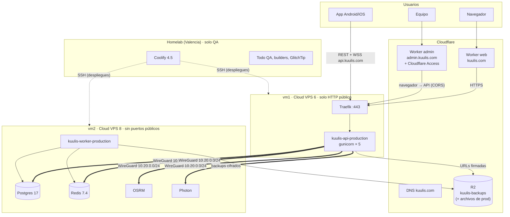

# Producción en 2 VPS (plan del 2026-10-25)

Decidido por Carlos el 2026-10-25: el homelab queda **solo para QA** y producción va en dos VPS tipo «Cloud VPS»
gestionados por el Coolify del homelab. La web pública ya está en Cloudflare Workers y el admin irá también allí.
Presupuesto máximo de infraestructura de producción: **~60 €/mes**.

Este documento es el plan. **Nada de esto existe todavía**: no se ha creado ningún servidor, DNS, app de Coolify ni
Worker. Cada paso que toque Coolify o Cloudflare necesita el OK de Carlos. Sustituye al plan del 2026-10-21 (un solo
VPS con todo) y al «VPS de contingencia apagado» de `deployment.md`, que ya no hace falta: el homelab deja de ser
producción.

Mapa actual de la infraestructura: [README.md](README.md). Runbooks: [`docs/deployment.md`](../deployment.md).
Capacidad medida: [`docs/scaling.md`](../scaling.md) y la prueba de carga del 2026-10-25.

## Reparto

| Máquina | Plan | Precio | Qué corre |
| --- | --- | --- | --- |
| **vm1** | Cloud VPS 6: 6 vCPU, 12 GB, NVMe | 7,26 €/mes | Traefik (proxy de Coolify) y la **API** |
| **vm2** | Cloud VPS 8: 8 vCPU, 24 GB, 150 GB NVMe | 13,55 €/mes | **Worker**, **Postgres**, **Redis**, **OSRM**, **Photon** |
| Cloudflare | gratis | 0 € | DNS, Worker de la web (`kuulis.com`), Worker del admin, R2 (backups y, si se aprueba, archivos de la app) |
| Homelab | ya pagado | 0 € | Coolify (gestiona QA y las dos VPS), todo QA, builders de APK/AAB, GlitchTip |

Total: **~20,8 €/mes** más IVA si el proveedor lo suma (con 21 %, ~25 €), más el posible recargo por región (ver
pregunta 1). Quedan ~35 € de margen para crecer (pregunta 9).

¿Por qué así? La prueba de carga dice que **la API es lo único que gasta CPU**: Postgres tenía 1–2 sesiones activas,
Redis y el disco iban sobrados. Con la API sola en vm1, nada le roba CPU; vm2 junta todo lo que necesita RAM y disco
pero poca CPU, y le sobra CPU para un segundo proceso de API si hace falta (pregunta 9).

## Diagrama

Ruta de una petición de la app: `app → Cloudflare DNS (api.kuulis.com) → Traefik en vm1 → API → (WireGuard) →
Postgres/Redis en vm2`. Ya no pasa por el Nginx Proxy Manager ni por la casa de Carlos.

## Contenedores por VM

Estimaciones a partir de la prueba de carga del 2026-10-25 (escala 1: 600 motorizados, 150 viajes simultáneos,
1500 pasajeros, ~155 req/s de media, p95 56 ms) y de `scaling.md` (~25 ms de CPU por petición en un hilo de un
i7-12700T; a escala 1 la API usó ~7,8 hilos y se rompe hacia ~230 req/s con 8 hilos).

### vm1 (6 vCPU, 12 GB)

| Contenedor | CPU | RAM (límite) | Disco | Notas |
| --- | --- | --- | --- | --- |
| API (`WEB_CONCURRENCY=5`) | 5 vCPU | 2 GB (uso ~150–250 MB por proceso) | imagen ~1 GB | 1 proceso por vCPU; se deja 1 vCPU para Traefik, el sistema y Docker |
| Traefik | ~0,3–0,5 vCPU a plena carga | 256 MB | — | TLS y WebSockets |
| Sistema, Docker, WireGuard | poco | ~1 GB | ~15 GB (SO + imágenes + caché de build) | |
| **Libre** | ~0 en pico | **~8 GB** | resto | La RAM sobra; la CPU es lo que se vende |

**Capacidad esperada de la API en vm1.** Un vCPU de VPS compartido rinde menos que un hilo del i7 de QA (no se
sabe cuánto hasta medirlo; suele estar entre el 50 y el 80 %). Con 5 procesos: entre ~100 y ~160 req/s de techo, y
**~70–110 req/s sostenidos** con la CPU al 70 % (el umbral de `scaling.md`). Eso son unos 1000–1500 usuarios
conectados a la vez con el uso simulado. El objetivo de 5000 usuarios activos al día (~500 a la vez, 25–50 req/s)
cabe con margen de 2–3×. **Hay que confirmarlo con la prueba de carga sobre vm1** (checklist, paso 19).

Pool de Postgres: 5 procesos × (8 + 2) = 50 conexiones como máximo.

### vm2 (8 vCPU, 24 GB, 150 GB)

| Contenedor | CPU | RAM (límite) | Disco | Notas |
| --- | --- | --- | --- | --- |
| Postgres 17 | < 1 vCPU (medido: 1–2 sesiones activas) | 6 GB (`shared_buffers=2GB`, `effective_cache_size=8GB`) | datos < 5 GB el primer año; reservar 30 GB | Con 24 GB se puede dar más caché que en QA |
| Redis 7.4 | < 0,5 vCPU | 1 GB (`maxmemory 768mb`, `noeviction`, AOF) | < 1 GB | Sesiones, cola, despacho, pub/sub |
| Worker (`WORKER_CONCURRENCY=2`) | ~0,5–1 vCPU, picos en los dumps | 1 GB | — | Despacho, cuotas, push, backups (`pg_dump` local, rápido al estar junto a Postgres) |
| OSRM (Venezuela) | < 0,5 vCPU (1,3 % del tiempo de la API va a `/rides/quote`) | 1,5 GB | ~3 GB | Build mensual: ~3 GB de RAM unos minutos |
| Photon (Venezuela) | < 0,5 vCPU | 1,5 GB | ~3 GB | Igual |
| Sistema, Docker, WireGuard | poco | ~1 GB | ~30 GB (imágenes y caché de build) | |
| **Libre** | **~5 vCPU** | **~11 GB** | **~80 GB** | Sitio para un 2.º proceso de API o PgBouncer |

`max_connections = 150` sigue bastando: API 50 + worker 2 × 10 = 70.

En producción OSRM y Photon pueden llevar **solo Venezuela** (build args `REGIONS` y `SOURCES`): Valencia (España) es
solo para las pruebas de Carlos en QA.

## Red entre vm1 y vm2

Regla: **solo la API y el worker hablan con Postgres y Redis**. Nada de vm2 se publica en internet.

1. **Mismo centro de datos.** Cada petición autenticada hace 1 consulta a Redis y 1 a Postgres más las del endpoint
   (3–6 idas y vueltas). Dentro del mismo centro de datos son ~0,3 ms cada una; entre regiones serían decenas de ms
   por petición. Las dos VPS se piden en la **misma región** y se comprueba con `ping` (< 1 ms) antes de seguir.
2. **WireGuard** entre las dos (gratis, sin depender del proveedor): `wg0` con `10.20.0.1` (vm1) y `10.20.0.2`
   (vm2), puerto UDP 51820 abierto solo a la IP pública de la otra VPS. Si el proveedor ofrece red privada gratis en
   la región, se puede usar en su lugar (pregunta 3).
3. **Servicios de vm2 publicados solo en la IP de WireGuard**: en Coolify, «Ports Mappings» con la IP delante
   (`10.20.0.2:5432:5432`, `10.20.0.2:6379:6379`, `10.20.0.2:5000:5000`, `10.20.0.2:2322:2322`). **No** usar «Make it
   publicly available» de las bases: publica en `0.0.0.0`.
4. **Cortafuegos con dos capas**:
   - `ufw` en las dos VPS: entrada denegada por defecto; vm1 abre 80/443 (y 22, ver abajo); vm2 abre solo 51820/udp
     desde vm1 y 22.
   - Docker se salta `ufw` en los puertos publicados, así que además una regla en la cadena `DOCKER-USER` de vm2 que
     tira todo lo que entre por la interfaz pública hacia contenedores. Así, aunque alguien publique un puerto por
     error, no se ve desde fuera.
   - Si el proveedor tiene cortafuegos en su panel, se pone igual (defensa extra, no sustituye a lo anterior).
5. **Contraseñas y TLS**: Postgres con usuario y contraseña largos (`scram-sha-256`), Redis con `requirepass`. El
   tráfico va cifrado por WireGuard, así que no hace falta TLS en Postgres/Redis.
6. **Variables de la API** (vm1): `DATABASE_URL=postgresql+asyncpg://kuulis:…@10.20.0.2:5432/kuulis`,
   `REDIS_URL=redis://:…@10.20.0.2:6379/0`, `OSRM_URL=http://10.20.0.2:5000`, `PHOTON_URL=http://10.20.0.2:2322`.
   El worker (vm2, misma red de Docker que las bases) usa los nombres internos de Coolify o el alias de red, como hoy.

Los alias de red de Coolify (`kuulis-osrm`, `kuulis-photon`) solo funcionan dentro de un mismo servidor; entre vm1 y
vm2 se usa la IP de WireGuard.

## Entrada pública (vm1)

- `api.kuulis.com` → A a la IP de vm1. Hoy `deployment.md` dice nube **gris** (solo DNS) para que la API vea la IP
  real sin más configuración. Recomendado pasar a **naranja** (pregunta 4): esconde la IP de vm1, da protección DDoS
  gratis y permite cerrar 80/443 a todo lo que no sea Cloudflare. Requiere:
  - Traefik de vm1 con `forwardedHeaders.trustedIPs` = rangos de Cloudflare (los publica en
    `cloudflare.com/ips`), para que la API reciba la IP del cliente en `X-Forwarded-For`. La API ya confía en las
    redes privadas de Docker (`FORWARDED_ALLOW_IPS` en `api/docker/entrypoint.sh`).
  - `ufw` en vm1: 80/443 solo desde los rangos de Cloudflare.
  - WebSockets: Cloudflare corta conexiones sin tráfico a los 100 s. Los motorizados mandan GPS cada 4 s; revisar que
    el socket del pasajero mande un ping antes de los 100 s (o que reconecte sin ruido).
- Certificados: Traefik de vm1 con Let's Encrypt (como cualquier servidor de Coolify), o certificado de origen de
  Cloudflare si va en naranja.
- vm2 no necesita proxy: en Coolify se le puede dejar el proxy parado.

## Coolify del homelab gestionando las VPS

- Cada VPS se añade en Coolify como **servidor remoto** (Servers → Add): Coolify entra por **SSH** con una clave
  dedicada, instala Docker y, en vm1, el proxy.
- **SSH**: solo con clave (sin contraseña ni `root` por contraseña), puerto 22 abierto solo a la IP pública del
  homelab (`81.202.2.12`, si es fija; pregunta 5) y a una segunda vía de emergencia de Carlos (su clave personal desde
  la consola web del proveedor, que no depende del puerto 22).
- Nuevo entorno de Coolify o el `production` actual con sus apps **movidas** de servidor: API en vm1; worker,
  Postgres, Redis, OSRM y Photon en vm2. OSRM y Photon de producción son apps nuevas en vm2 (las de hoy se quedan para
  QA). Carlos crea las apps nuevas en la UI (los cambios por la API de Coolify necesitan su OK).
- **Builds**: por defecto Coolify construye la imagen en el servidor de destino. En vm1 eso significa ~1–2 min de
  CPU compartida con la API durante cada despliegue. Para empezar vale (desplegar fuera de la hora pico); más adelante
  se puede construir en GitHub Actions y publicar en GHCR (pregunta 6).
- Auto-deploy de `main` desde la GitHub App, como hoy.

### Si el homelab se cae

| Sigue funcionando | Se pierde hasta que vuelva |
| --- | --- |
| API, worker, Postgres, Redis, OSRM, Photon (Docker los arranca solos, también tras reiniciar la VPS) | Desplegar (los webhooks de GitHub fallan; al volver, «Redeploy» a mano) |
| Traefik y los certificados ya emitidos | Panel de Coolify, sus métricas y sus avisos |
| Backups a R2 (los hace el worker, no Coolify) y alertas por Telegram (también el worker) | Errores en GlitchTip si sigue en el homelab (pregunta 7) |
| Web y admin en Cloudflare | Builds de APK/AAB y OTA nuevas (los builders siguen en el homelab) |
| | **Archivos de la app** (documentos, avatares, OTA) si siguen en el MinIO de casa → por eso la pregunta 2 |

No hay tareas programadas de Coolify en producción: todo lo periódico lo hace el worker (Taskiq). Si el homelab se
pierde del todo, se instala Coolify en otro sitio y se vuelven a añadir las dos VPS con la clave SSH (guardarla
también en el gestor de contraseñas); los contenedores siguen corriendo mientras tanto.

## Admin en Cloudflare Workers

El admin es una SPA (`ssr: false`) y llama a la API con `Authorization: Bearer`; los tokens están en cookies de su
propio dominio. Puede ir en un Worker como la web.

1. **Worker `kuulis-admin`** con Workers Builds sobre `carlozrodri/kuulis`, raíz `admin`, rama `main`. Build con el
   preset de Nitro `cloudflare_module` (igual que `web/`), así los `routeRules` siguen poniendo la CSP y las cabeceras.
   Hace falta un PR de código: `admin/wrangler.jsonc` y un script `build:cloudflare`.
2. **Dominio** `admin.kuulis.com` (Custom domain del Worker). Delante, **Cloudflare Access** (gratis hasta 50
   usuarios) con email del equipo: el panel ni se ve sin pasar por Access, y el 2FA del admin sigue igual.
3. **Variables**: `NUXT_PUBLIC_API_BASE=https://api.kuulis.com/api/v1` (también en el build),
   `NUXT_PUBLIC_APP_ENV=production`, `NUXT_STORAGE_ORIGIN` = el origen del S3 de producción (R2 si se aprueba la
   pregunta 2).
4. **CSP**: hoy `connect-src 'self' <S3>`. Con la API en otro origen hay que añadir `https://api.kuulis.com` (mismo
   PR de código).
5. **API**: `CORS_ORIGINS` de producción con `https://admin.kuulis.com` (además de `https://kuulis.com` y
   `https://www.kuulis.com`), `ADMIN_URL=https://admin.kuulis.com`, `PUBLIC_URL=https://api.kuulis.com`. Son valores por
   defecto en `api/kuulis/settings/production.py` (hoy apuntan a `kuulis-prod.top8.uk`); se cambian en el mismo PR o
   por variable en Coolify.
6. Los límites de uso del login del admin siguen viendo la IP real: el navegador llama directo a la API, no a través
   del Worker.
7. Se apaga `kuulis-admin-production` en Coolify.

Dominios de producción resultantes:

| Dominio | Dónde | Nube |
| --- | --- | --- |
| `kuulis.com`, `www.kuulis.com` | Worker `kuulis` (ya existe) | Worker |
| `admin.kuulis.com` | Worker `kuulis-admin` + Access | Worker |
| `api.kuulis.com` | vm1 (Traefik → API) | naranja recomendado (pregunta 4) |
| `files.kuulis.com` (si R2) | Bucket de archivos de producción | R2 |

El comodín `*.kuulis.com → homelab` de hoy sigue para QA, pero los registros concretos de arriba ganan sobre él.

## Backups y R2

- **Igual que en QA**: el worker de producción hace dump cifrado cada 15 min, copia diaria, libro contable diario,
  copia de archivos y prueba de restauración semanal, todo a `kuulis-backups/production/` en R2 (`deployment.md` →
  Backups). En vm2 el `pg_dump` es local a Postgres: rápido y sin tráfico entre VMs.
- **Token de R2 propio de producción** (Object Read & Write solo a ese bucket) y `BACKUP_PASSPHRASE` distinta de QA,
  guardada también en el gestor de contraseñas.
- **Pendiente en el bucket** (hallazgo 2 de [README.md](README.md)): reglas de retención de `production/` (recent 2
  días, daily 14, ledger 365) y *bucket lock rules*. Hoy solo hay reglas de `qa/`.
- **Archivos de la app** (documentos de motorizados, avatares, adjuntos, OTA): hoy en el MinIO del homelab. Si
  producción sigue usándolo, una caída de casa rompe documentos y actualizaciones aunque la API siga arriba.
  Recomendado un bucket R2 `kuulis-files-production` (pregunta 2): 10 GB gratis, sin coste de salida, la API ya
  habla S3 (`AWS_S3_ENDPOINT`). Necesita CORS en el bucket para las subidas directas del admin y la app.
- El backup de Coolify (al MinIO) no se usa en producción; el bueno es el del worker.
- **Restauración de desastre**: si se pierde vm2, se crea otra VPS, se añade a Coolify, se restaura el último dump de
  R2 (`deployment.md` → Restaurar Postgres) y se cambia la IP de WireGuard en las variables de la API. Pérdida máxima:
  15 min de datos. Si se pierde vm1, basta con otra VPS y redeploy de la API (no guarda datos).

## Checklist de lanzamiento

Orden propuesto. Los pasos marcados con **(Carlos)** los hace Carlos o necesitan su OK.

**Máquinas y red**
1. **(Carlos)** Contratar vm1 y vm2 en la misma región (pregunta 1), Ubuntu 24.04, con su clave SSH.
2. Endurecer las dos: usuario no root con sudo, SSH solo con clave, `unattended-upgrades`, zona horaria UTC.
3. WireGuard `10.20.0.1` ↔ `10.20.0.2`; comprobar `ping` < 1 ms.
4. `ufw` y reglas `DOCKER-USER` como en «Red»; comprobar desde fuera (`nmap` a la IP pública de vm2: nada abierto
   salvo 22 y 51820/udp).

**Coolify**
5. **(Carlos)** Añadir vm1 y vm2 como servidores remotos; proxy solo en vm1.
6. **(Carlos)** Crear en vm2: Postgres y Redis de producción con la configuración de `deployment.md` (ajustada a la
   tabla de vm2) y puertos solo en `10.20.0.2`; OSRM y Photon de producción (solo Venezuela).
7. **(Carlos)** Mover o crear API (vm1) y worker (vm2) de producción con todas las variables (la lista de producción
   está incompleta desde 2026-10-09, ver [README.md](README.md)); `WEB_CONCURRENCY=5`, `DB_POOL_SIZE=8`,
   `DB_MAX_OVERFLOW=2`, límites de RAM de las tablas.
8. Sentry/GlitchTip en producción **sin trazas por petición** (la prueba de carga midió ~7 % de CPU de la API en
   Sentry), solo errores.

**Cloudflare**
9. **(Carlos)** DNS `api.kuulis.com` → vm1; Traefik con los rangos de Cloudflare si va en naranja.
10. **(Carlos)** Bucket R2 de archivos (si pregunta 2 = sí), su CORS, dominio `files.kuulis.com`, token; variables
    `AWS_*` de producción.
11. **(Carlos)** Reglas de retención y bloqueo de `production/` en `kuulis-backups`; token y `BACKUP_*` del worker.
12. PR de código del admin para Workers (wrangler, CSP, settings de producción) → **(Carlos)** Worker `kuulis-admin`,
    dominio `admin.kuulis.com` y Access.
13. **(Carlos)** Worker de la web: rama `main` y variables a `https://api.kuulis.com/api/v1`; redeploy.

**Encendido** (`deployment.md` → Encender producción)
14. `GET https://api.kuulis.com/api/health/ready` en `ok` con base, Redis, OSRM y Photon en `true` y el commit de
    `main`.
15. Primer admin, cambio de contraseña, configuración inicial (Caracas, tarifas, tramos, tasas, Binance).
16. Comprobar en Sistema → Backups que hay dump en R2 a los 15 min; lanzar una restauración de prueba.
17. UptimeRobot sobre `https://api.kuulis.com/api/health/live` y la web.
18. Smoke E2E contra producción una vez.

**Prueba de carga sobre vm1** (antes de abrir a usuarios)
19. Repetir la prueba de escala 1 (`loadtest/README.md`) contra `api.kuulis.com` **en vm1 real**, con la base de
    vm2, desde el `kuulis-loadtest` del homelab (o desde una VPS por horas si la subida de casa limita). Medir CPU de
    vm1 con `node-exporter` sobre los 6 vCPU. Objetivo: p95 < 300 ms, 0 errores 5xx, asignación p95 < 5 s. Sacar el
    techo real de req/s y apuntarlo en `scaling.md`.
20. Después, borrar los datos sintéticos (las cuentas de carga) o hacer la prueba antes del paso 15 y vaciar la base.
21. Simular la caída del homelab (parar Coolify 10 min) y comprobar que la app sigue funcionando.
22. **(Carlos)** App de la tienda apuntando a `api.kuulis.com` (perfil `production`/`play` de EAS) y OTA de producción
    con su propia clave de firma.

## Riesgos

- **CPU compartida del VPS**: los vCPU de estos planes se comparten con otros clientes y su rendimiento varía. Es la
  única cifra que la prueba en QA no puede dar; por eso el paso 19.
- **API en un solo contenedor**: un despliegue o un fallo de vm1 corta la API ~40 s (medido en `scaling.md`). Normal
  para este tamaño; se mitiga desplegando fuera de la hora pico.
- **Un despliegue construye en vm1** y le quita CPU a la API un par de minutos (pregunta 6).
- **Coolify en casa**: si el homelab cae no se puede desplegar un arreglo urgente. Plan B: desplegar a mano por SSH
  (`docker compose` del último despliegue) o reinstalar Coolify en otro sitio.
- **MinIO en casa** para los archivos de producción, si no se mueve a R2 (pregunta 2).
- **Puertos publicados por Docker** saltándose `ufw`: cubierto con `DOCKER-USER`, pero hay que comprobarlo tras cada
  cambio de puertos en Coolify (paso 4).

## Preguntas para Carlos

1. **¿En qué región van las VPS?** Recomendado: **EE. UU. Este** (Nueva York o similar), la más cercana a Venezuela
   (~50–80 ms frente a ~150 ms desde Europa), y las dos en la misma. Algunos proveedores cobran un recargo mensual por
   región fuera de Europa; aun así queda muy por debajo de 60 €.
2. **¿Los archivos de producción van a R2 en vez del MinIO de casa?** Recomendado: **sí**, bucket
   `kuulis-files-production`. Sin esto, una caída del homelab rompe documentos, avatares y OTA de producción.
3. **¿WireGuard o red privada del proveedor?** Recomendado: **WireGuard**, gratis y portable entre proveedores. La red
   privada solo si es gratis y en la misma región.
4. **¿`api.kuulis.com` con nube naranja?** Recomendado: **sí**, con Traefik confiando en los rangos de Cloudflare y
   80/443 abiertos solo a Cloudflare. Esconde la IP de vm1 y da protección DDoS.
5. **¿La IP pública del homelab (`81.202.2.12`) es fija?** Si lo es, SSH de las VPS abierto solo a ella. Si no,
   recomendado: Coolify entra por WireGuard (el homelab como tercer nodo `10.20.0.10`) y el puerto 22 público se cierra.
6. **¿Dónde se construyen las imágenes de producción?** Recomendado: **de momento en el propio servidor** (lo que hace
   Coolify por defecto) desplegando fuera de la hora pico; pasar a GitHub Actions + GHCR si los despliegues frecuentes
   se notan en la API.
7. **¿Errores de producción en GlitchTip del homelab o en sentry.io?** Recomendado: **sentry.io plan gratis** (5000
   errores/mes) solo errores, sin trazas: no depende de casa y no cuesta CPU de una instancia propia. Alternativa
   gratis: GlitchTip del homelab, aceptando perder errores durante una caída.
8. **¿Admin detrás de Cloudflare Access?** Recomendado: **sí** (gratis hasta 50 usuarios, email del equipo).
9. **¿Qué hacer con el margen de presupuesto (~35 €)?** Recomendado: **nada hasta la prueba del paso 19**. Si vm1
   se queda corta, primer paso gratis: un segundo proceso de API en vm2 (le sobran ~5 vCPU) con Traefik de vm1
   repartiendo entre los dos por WireGuard; segundo paso: subir vm1 de plan.
10. **¿El entorno `production` de Coolify se reutiliza moviendo sus apps a las VPS, o se crean apps nuevas?**
    Recomendado: **apps nuevas** en las VPS y borrar las viejas del homelab cuando producción funcione (las viejas
    están paradas y les faltan variables).
