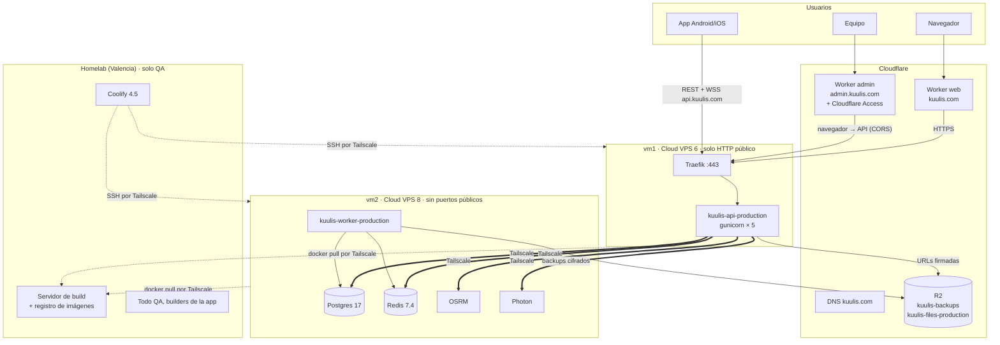

# Producción en 2 VPS (plan del 2026-10-25)

Decidido por Carlos el 2026-10-25: el homelab queda **solo para QA** y producción va en dos VPS tipo «Cloud VPS»
gestionados por el Coolify del homelab. La web pública ya está en Cloudflare Workers y el admin irá también allí.
Presupuesto máximo de infraestructura de producción: **~60 €/mes**.

Carlos respondió las 10 preguntas el 2026-10-25 (ver «Decisiones» al final); el documento ya las aplica.

Este documento es el plan. **Nada de esto existe todavía**: no se ha creado ningún servidor, DNS, app de Coolify ni
Worker. Cada paso que toque Coolify o Cloudflare necesita el OK de Carlos. Sustituye al plan del 2026-10-21 (un solo
VPS con todo) y al «VPS de contingencia apagado» de `deployment.md`, que ya no hace falta: el homelab deja de ser
producción.

Mapa actual de la infraestructura: [README.md](README.md). Runbooks: [`docs/deployment.md`](../deployment.md).
Capacidad medida: [`docs/scaling.md`](../scaling.md) y la prueba de carga del 2026-10-25.

## Reparto

| Máquina | Plan | Precio | Qué corre |
| --- | --- | --- | --- |
| **vm1** | Cloud VPS 6: 6 vCPU, 12 GB, NVMe | 7,26 €/mes | Traefik (proxy de Coolify) y la **API** |
| **vm2** | Cloud VPS 8: 8 vCPU, 24 GB, 150 GB NVMe | 13,55 €/mes | **Worker**, **Postgres**, **Redis**, **OSRM**, **Photon** |
| Cloudflare | gratis | 0 € | DNS, Worker de la web (`kuulis.com`), Worker del admin, Access, R2 (backups y archivos de la app) |
| Homelab | ya pagado | 0 € | Coolify (gestiona QA y las dos VPS), **construye las imágenes de producción**, registro de imágenes, todo QA, builders de APK/AAB |
| Tailscale | gratis (plan personal) | 0 € | Red privada entre vm1, vm2 y el homelab |
| Sentry | gratis (plan Developer) | 0 € | Errores de producción |

Total: **~20,8 €/mes** más IVA si el proveedor lo suma (con 21 %, ~25 €), más el posible recargo por la región de
EE. UU. Este. Quedan ~35 € de margen: decidido no gastarlo por ahora y, cuando haga falta,
añadir otra VM (para la API o lo que lo necesite).

¿Por qué así? La prueba de carga dice que **la API es lo único que gasta CPU**: Postgres tenía 1–2 sesiones activas,
Redis y el disco iban sobrados. Con la API sola en vm1, nada le roba CPU; vm2 junta todo lo que necesita RAM y disco
pero poca CPU.

## Diagrama

Ruta de una petición de la app: `app → Cloudflare DNS (api.kuulis.com) → Traefik en vm1 → API → (Tailscale) →
Postgres/Redis en vm2`. Ya no pasa por el Nginx Proxy Manager ni por la casa de Carlos.

## Contenedores por VM

Estimaciones a partir de la prueba de carga del 2026-10-25 (escala 1: 600 motorizados, 150 viajes simultáneos,
1500 pasajeros, ~155 req/s de media, p95 56 ms) y de `scaling.md` (~25 ms de CPU por petición en un hilo de un
i7-12700T; a escala 1 la API usó ~7,8 hilos y se rompe hacia ~230 req/s con 8 hilos).

### vm1 (6 vCPU, 12 GB)

| Contenedor | CPU | RAM (límite) | Disco | Notas |
| --- | --- | --- | --- | --- |
| API (`WEB_CONCURRENCY=5`) | 5 vCPU | 2 GB (uso ~150–250 MB por proceso) | imagen ~1 GB | 1 proceso por vCPU; se deja 1 vCPU para Traefik, el sistema y Docker |
| Traefik | ~0,3–0,5 vCPU a plena carga | 256 MB | — | TLS y WebSockets |
| Sistema, Docker, Tailscale | poco | ~1 GB | ~10 GB (SO + imágenes; no se construye aquí) | |
| **Libre** | ~0 en pico | **~8 GB** | resto | La RAM sobra; la CPU es lo que se vende |

**Capacidad esperada de la API en vm1.** Un vCPU de VPS compartido rinde menos que un hilo del i7 de QA (no se
sabe cuánto hasta medirlo; suele estar entre el 50 y el 80 %). Con 5 procesos: entre ~100 y ~160 req/s de techo, y
**~70–110 req/s sostenidos** con la CPU al 70 % (el umbral de `scaling.md`). Eso son unos 1000–1500 usuarios
conectados a la vez con el uso simulado. El objetivo de 5000 usuarios activos al día (~500 a la vez, 25–50 req/s)
cabe con margen de 2–3×. **Hay que confirmarlo con la prueba de carga sobre vm1** (checklist, paso 15).

Pool de Postgres: 5 procesos × (8 + 2) = 50 conexiones como máximo.

### vm2 (8 vCPU, 24 GB, 150 GB)

| Contenedor | CPU | RAM (límite) | Disco | Notas |
| --- | --- | --- | --- | --- |
| Postgres 17 | < 1 vCPU (medido: 1–2 sesiones activas) | 6 GB (`shared_buffers=2GB`, `effective_cache_size=8GB`) | datos < 5 GB el primer año; reservar 30 GB | Con 24 GB se puede dar más caché que en QA |
| Redis 7.4 | < 0,5 vCPU | 1 GB (`maxmemory 768mb`, `noeviction`, AOF) | < 1 GB | Sesiones, cola, despacho, pub/sub |
| Worker (`WORKER_CONCURRENCY=2`) | ~0,5–1 vCPU, picos en los dumps | 1 GB | — | Despacho, cuotas, push, backups (`pg_dump` local, rápido al estar junto a Postgres) |
| OSRM (Venezuela) | < 0,5 vCPU (1,3 % del tiempo de la API va a `/rides/quote`) | 1,5 GB | ~3 GB | La imagen (con el mapa) se construye en el homelab |
| Photon (Venezuela) | < 0,5 vCPU | 1,5 GB | ~3 GB | Igual |
| Sistema, Docker, Tailscale | poco | ~1 GB | ~20 GB (SO + imágenes; no se construye aquí) | |
| **Libre** | **~5 vCPU** | **~11 GB** | **~90 GB** | Margen para PgBouncer o picos del worker |

`max_connections = 150` sigue bastando: API 50 + worker 2 × 10 = 70.

En producción OSRM y Photon pueden llevar **solo Venezuela** (build args `REGIONS` y `SOURCES`): Valencia (España) es
solo para las pruebas de Carlos en QA.

## Red entre vm1, vm2 y el homelab (Tailscale)

Regla: **solo la API y el worker hablan con Postgres y Redis**. Nada de vm2 se publica en internet.

1. **Mismo centro de datos.** Cada petición autenticada hace 1 consulta a Redis y 1 a Postgres más las del endpoint
   (3–6 idas y vueltas). Dentro del mismo centro de datos son ~0,3 ms cada una; entre regiones serían decenas de ms
   por petición. Las dos VPS se piden en **EE. UU. Este** y en la misma ubicación, y se comprueba con `ping`
   (< 1 ms) antes de seguir.
2. **Tailscale** (decidido; WireGuard por debajo). Se eligió frente a WireGuard a mano porque el homelab también
   tiene que entrar en la red (SSH de Coolify y registro de imágenes) y Tailscale lo hace **sin abrir puertos en casa**,
   que va en la línea de cerrar las IP públicas del homelab con Cloudflare Tunnel más adelante. Plan personal gratis.
   - Nodos: `kuulis-vm1`, `kuulis-vm2` y el servidor del homelab donde corren Coolify y el build. Cada uno tiene una
     IP `100.x.y.z` fija; se apuntan aquí cuando existan.
   - **ACL de Tailscale** (en su panel): vm1 → vm2 solo a 5432, 6379, 5000 y 2322; homelab → vm1 y vm2 a 22; vm1 y
     vm2 → homelab solo al puerto del registro de imágenes. Nada más.
   - Claves de nodo **sin caducidad** en las VPS (si caduca la clave se corta la base) y aviso por email de Tailscale.
   - Las VPS hablan entre sí de forma directa (punto a punto) dentro del centro de datos; comprobar con
     `tailscale ping kuulis-vm2` que dice `via <IP>` y no `via DERP` (relé, más lento).
3. **Servicios de vm2 publicados solo en la IP de Tailscale**: en Coolify, «Ports Mappings» con la IP delante
   (`100.x.y.z:5432:5432`, igual para 6379, 5000 y 2322). **No** usar «Make it publicly available» de las bases:
   publica en `0.0.0.0`. Docker arranca antes que Tailscale tras un reinicio, así que el servicio de Docker se ordena
   después de `tailscaled` (`After=tailscaled.service` en un override de systemd) para que la IP exista al publicar.
4. **Cortafuegos con dos capas**:
   - `ufw` en las dos VPS: entrada denegada por defecto salvo `tailscale0`; vm1 abre además 443 (y 80) solo a los
     rangos de Cloudflare. vm2 no abre nada en la interfaz pública. El puerto 22 público se cierra en las dos: se entra
     por Tailscale.
   - Docker se salta `ufw` en los puertos publicados, así que además una regla en la cadena `DOCKER-USER` que tira
     todo lo que entre por la interfaz pública hacia contenedores (en vm1, salvo 80/443 de Traefik). Así, aunque
     alguien publique un puerto por error, no se ve desde fuera.
   - Si el proveedor tiene cortafuegos en su panel, se pone igual (defensa extra, no sustituye a lo anterior).
   - Vía de emergencia si Tailscale falla: la consola web (VNC) del proveedor, que no depende de la red.
5. **Contraseñas y TLS**: Postgres con usuario y contraseña largos (`scram-sha-256`), Redis con `requirepass`. El
   tráfico va cifrado por Tailscale, así que no hace falta TLS en Postgres/Redis.
6. **Variables de la API** (vm1): `DATABASE_URL=postgresql+asyncpg://kuulis:…@<ip-ts-vm2>:5432/kuulis`,
   `REDIS_URL=redis://:…@<ip-ts-vm2>:6379/0`, `OSRM_URL=http://<ip-ts-vm2>:5000`, `PHOTON_URL=http://<ip-ts-vm2>:2322`.
   Con la IP y no con el nombre de MagicDNS: los contenedores no siempre resuelven los nombres de Tailscale.
   El worker (vm2, misma red de Docker que las bases) usa los nombres internos de Coolify o el alias de red, como hoy.

Los alias de red de Coolify (`kuulis-osrm`, `kuulis-photon`) solo funcionan dentro de un mismo servidor; entre vm1 y
vm2 se usa la IP de Tailscale.

## Entrada pública (vm1)

- `api.kuulis.com` → A a la IP de vm1. Hoy `deployment.md` dice nube **gris** (solo DNS) para que la API vea la IP
  real sin más configuración. **Decidido: naranja**. Esconde la IP de vm1, da protección DDoS
  gratis y permite cerrar 80/443 a todo lo que no sea Cloudflare. Requiere:
  - Traefik de vm1 con `forwardedHeaders.trustedIPs` = rangos de Cloudflare (los publica en
    `cloudflare.com/ips`), para que la API reciba la IP del cliente en `X-Forwarded-For`. La API ya confía en las
    redes privadas de Docker (`FORWARDED_ALLOW_IPS` en `api/docker/entrypoint.sh`).
  - `ufw` en vm1: 80/443 solo desde los rangos de Cloudflare.
  - WebSockets: Cloudflare corta conexiones sin tráfico a los 100 s. Los motorizados mandan GPS cada 4 s; revisar que
    el socket del pasajero mande un ping antes de los 100 s (o que reconecte sin ruido).
- Certificados: certificado de origen de Cloudflare en Traefik de vm1 (15 años, modo SSL «Full (strict)»), o Let's
  Encrypt como cualquier servidor de Coolify.
- vm2 no necesita proxy: en Coolify se le puede dejar el proxy parado.

## Coolify del homelab gestionando las VPS

- Cada VPS se añade en Coolify como **servidor remoto** (Servers → Add) con su **IP de Tailscale**: Coolify entra por
  **SSH** con una clave dedicada, instala Docker y, en vm1, el proxy. SSH solo con clave, sin `root` por contraseña,
  y escuchando solo en Tailscale (el 22 público, cerrado). Así no importa si la IP de casa cambia ni hace falta abrir
  nada en el router. La clave SSH de Coolify se guarda también en el gestor de contraseñas.
- **Se reutiliza el entorno `production`** de Coolify (decidido): sus apps se mueven a las VPS (API a vm1; worker,
  Postgres y Redis a vm2) y se completan las variables. OSRM y Photon de producción son apps nuevas en vm2 (las de
  hoy se quedan para QA). La base de producción **se limpia** antes de abrir: se vacían las cuentas y datos de
  prueba del 2026-10-09 que no sirvan para producción y lo que dejen la prueba de carga y el smoke; lo demás se
  conserva (decidido, ver checklist). Carlos crea y mueve las apps en
  la UI (los cambios por la API de Coolify necesitan su OK).

### Builds en el homelab, nunca en producción (decidido)

Por defecto Coolify construye la imagen en el servidor de destino, lo que le quitaría CPU a la API en cada
despliegue. En su lugar:

1. Un servidor del homelab marcado en Coolify como **build server** (Servers → servidor → «Use it as a build
   server»). Coolify no deja desplegar apps en un build server, así que no puede ser el servidor `localhost` que corre
   QA. **Decidido: `node-1`** (`192.168.0.68`, hoy vacío), con el registro también ahí. Recursos:

   | | Mínimo | Recomendado | Por qué |
   | --- | --- | --- | --- |
   | CPU | 2 hilos | 4 hilos | La imagen de la API tarda ~1–2 min; OSRM/Photon, más, una vez al mes |
   | RAM | 6 GB | 8 GB | El preprocesado de OSRM usa ~3 GB y Photon ~2 GB; con 8 GB caben a la vez con la API |
   | Disco | 60 GB | 100 GB | Caché de build (~15 GB) + registro: ~1 GB por imagen de API/worker y ~3 GB por OSRM/Photon, guardando las 5 últimas de cada una (~40 GB) |

   Los builders de APK/AAB no cambian: siguen en `localhost` y no usan este servidor.
2. Un **registro de imágenes privado en el homelab** (contenedor `registry:2` con usuario y contraseña), alcanzable
   solo por Tailscale. Gratis y sin límite de tamaño; las imágenes de la API pesan ~1 GB y el plan gratis de GHCR
   para repos privados se quedaría corto. Docker exige HTTPS para un registro: certificado con `tailscale cert` para
   su nombre `*.ts.net` (lo más limpio) o `insecure-registries` con su IP de Tailscale en las VPS (el tráfico ya va
   cifrado por Tailscale).
3. Cada app de producción en Coolify con «Docker Registry» = ese registro: Coolify construye en el build server, sube
   la imagen y las VPS solo hacen `docker pull` y arrancan.
4. OSRM y Photon igual: el preprocesado del mapa (~3 GB de RAM) ocurre en casa, no en vm2.

Si el homelab cae, las VPS siguen con las imágenes que ya tienen descargadas; solo no se puede desplegar algo nuevo.
Postgres y Redis usan las imágenes oficiales de Docker Hub, como hoy. El auto-deploy de `main` sigue llegando por la
GitHub App.

### Si el homelab se cae

| Sigue funcionando | Se pierde hasta que vuelva |
| --- | --- |
| API, worker, Postgres, Redis, OSRM, Photon (Docker los arranca solos, también tras reiniciar la VPS) | Desplegar (los webhooks de GitHub fallan; al volver, «Redeploy» a mano) |
| Traefik y los certificados ya emitidos | Panel de Coolify, sus métricas y sus avisos |
| Backups a R2 (los hace el worker, no Coolify) y alertas por Telegram (también el worker) | El registro de imágenes (las VPS ya tienen las suyas) |
| Errores en Sentry (sentry.io) y archivos en R2 | |
| Web y admin en Cloudflare | Builds de APK/AAB y OTA nuevas (los builders siguen en el homelab) |

No hay tareas programadas de Coolify en producción: todo lo periódico lo hace el worker (Taskiq). Si el homelab se
pierde del todo, se instala Coolify en otro sitio, se une a Tailscale y se vuelven a añadir las dos VPS con la
clave SSH; los contenedores siguen corriendo mientras tanto.

Más adelante (deseo de Carlos, fuera de este plan): la entrada pública de QA y del panel de Coolify por **Cloudflare
Tunnel** y cerrar las IP públicas del homelab. No cambia nada de producción: las VPS ya no dependen de esa IP.

## Admin en Cloudflare Workers

El admin es una SPA (`ssr: false`) y llama a la API con `Authorization: Bearer`; los tokens están en cookies de su
propio dominio. Puede ir en un Worker como la web.

1. **Worker `kuulis-admin`** con Workers Builds sobre `carlozrodri/kuulis`, raíz `admin`, rama `main`. Build con el
   preset de Nitro `cloudflare_module` (igual que `web/`), así los `routeRules` siguen poniendo la CSP y las cabeceras.
   Hace falta un PR de código: `admin/wrangler.jsonc` y un script `build:cloudflare`.
2. **Dominio** `admin.kuulis.com` (Custom domain del Worker). Delante, **Cloudflare Access** (gratis hasta 50
   usuarios) con email del equipo: el panel ni se ve sin pasar por Access, y el 2FA del admin sigue igual. Decidido: **todo lo
   interno detrás de Access** (admin, y cuando pasen por Cloudflare Tunnel también el panel de Coolify y las
   herramientas de QA). La API, la web y `files.kuulis.com` no: los usan la app y el público.
3. **Variables**: `NUXT_PUBLIC_API_BASE=https://api.kuulis.com/api/v1` (también en el build),
   `NUXT_PUBLIC_APP_ENV=production`, `NUXT_STORAGE_ORIGIN=https://files.kuulis.com` (R2 de producción).
4. **CSP**: hoy `connect-src 'self' <S3>`. Con la API en otro origen hay que añadir `https://api.kuulis.com` (mismo
   PR de código).
5. **API**: `CORS_ORIGINS` de producción con `https://admin.kuulis.com` (además de `https://kuulis.com` y
   `https://www.kuulis.com`), `ADMIN_URL=https://admin.kuulis.com`, `PUBLIC_URL=https://api.kuulis.com`. Son valores por
   defecto en `api/kuulis/settings/production.py` (hoy apuntan a `kuulis-prod.top8.uk`); se cambian en el mismo PR o
   por variable en Coolify.
6. Los límites de uso del login del admin siguen viendo la IP real: el navegador llama directo a la API, no a través
   del Worker.
7. Se apaga `kuulis-admin-production` en Coolify.

Dominios de producción resultantes:

| Dominio | Dónde | Nube |
| --- | --- | --- |
| `kuulis.com`, `www.kuulis.com` | Worker `kuulis` (ya existe) | Worker |
| `admin.kuulis.com` | Worker `kuulis-admin` + Access | Worker |
| `api.kuulis.com` | vm1 (Traefik → API) | naranja |
| `files.kuulis.com` | Bucket R2 `kuulis-files-production` | R2 |

El comodín `*.kuulis.com → homelab` de hoy sigue para QA, pero los registros concretos de arriba ganan sobre él.

## Backups y R2

- **Igual que en QA**: el worker de producción hace dump cifrado cada 15 min, copia diaria, libro contable diario,
  copia de archivos y prueba de restauración semanal, todo a `kuulis-backups/production/` en R2 (`deployment.md` →
  Backups). En vm2 el `pg_dump` es local a Postgres: rápido y sin tráfico entre VMs.
- **Token de R2 propio de producción** (Object Read & Write solo a ese bucket) y `BACKUP_PASSPHRASE` distinta de QA,
  guardada también en el gestor de contraseñas.
- **Pendiente en el bucket** (hallazgo 2 de [README.md](README.md)): reglas de retención de `production/` (recent 2
  días, daily 14, ledger 365) y *bucket lock rules*. Hoy solo hay reglas de `qa/`.
- **Archivos de la app** (documentos de motorizados, avatares, adjuntos, OTA): **decidido, a R2** al pasar a
  producción, bucket `kuulis-files-production`. QA sigue en el MinIO de casa. 10 GB gratis, sin coste de salida, la
  API ya habla S3 (`AWS_S3_ENDPOINT`). Necesita CORS en el bucket para las subidas directas del admin y la app, y
  el builder de OTA de producción sube ahí. El backup diario `files/` de R2 a R2 sigue sirviendo contra borrados.
- El backup de Coolify (al MinIO) no se usa en producción; el bueno es el del worker.
- **Restauración de desastre**: si se pierde vm2, se crea otra VPS, se une a Tailscale, se añade a Coolify, se restaura
  el último dump de R2 (`deployment.md` → Restaurar Postgres) y se cambia la IP de Tailscale en las variables de la API. Pérdida máxima:
  15 min de datos. Si se pierde vm1, basta con otra VPS y redeploy de la API (no guarda datos).

## Checklist de lanzamiento

Orden propuesto. Los pasos marcados con **(Carlos)** los hace Carlos o necesitan su OK.

**Máquinas y red**
1. **(Carlos)** Contratar vm1 y vm2 en EE. UU. Este, misma ubicación, Ubuntu 24.04, con su clave SSH.
2. Endurecer las dos: usuario no root con sudo, SSH solo con clave, `unattended-upgrades`, zona horaria UTC.
3. **(Carlos)** Tailscale en vm1, vm2 y el servidor del homelab; ACL como en «Red»; claves sin caducidad en las VPS.
   Comprobar `tailscale ping` directo (no DERP) y < 1 ms entre las VPS.
4. `ufw`, `DOCKER-USER` y SSH solo por Tailscale como en «Red»; comprobar desde fuera (`nmap` a las IP públicas:
   vm2 sin nada abierto, vm1 solo 80/443).

**Coolify**
5. **(Carlos)** Añadir vm1 y vm2 como servidores remotos por su IP de Tailscale; proxy solo en vm1.
6. **(Carlos)** Build server en el homelab (`node-1` recomendado) y registro de imágenes privado por Tailscale;
   configurarlo en las apps de producción. Comprobar que un despliegue no construye nada en las VPS.
7. **(Carlos)** Mover Postgres y Redis de `production` a vm2 con la configuración de `deployment.md` (ajustada a la
   tabla de vm2) y puertos solo en la IP de Tailscale; crear OSRM y Photon de producción (solo Venezuela) en vm2.
8. **(Carlos)** Mover API (vm1) y worker (vm2) de `production` y completar todas las variables (la lista está
   incompleta desde 2026-10-09, ver [README.md](README.md)); `WEB_CONCURRENCY=5`, `DB_POOL_SIZE=8`,
   `DB_MAX_OVERFLOW=2`, límites de RAM de las tablas.
9. **(Carlos)** Proyecto de **Sentry** (sentry.io, plan gratis) para producción: `SENTRY_DSN` y `SENTRY_ENABLED=true`
   en API y worker, **sin trazas por petición** (la prueba de carga midió ~7 % de CPU de la API en Sentry), solo
   errores. QA sigue con GlitchTip.

**Cloudflare**
10. **(Carlos)** DNS `api.kuulis.com` → vm1 en naranja; Traefik de vm1 con los rangos de Cloudflare en `trustedIPs`.
11. **(Carlos)** Bucket R2 `kuulis-files-production`, su CORS, dominio `files.kuulis.com`, token; variables `AWS_*`
    de producción (API, worker y builder de producción).
12. **(Carlos)** Reglas de retención y bloqueo de `production/` en `kuulis-backups`; token y `BACKUP_*` del worker.
13. PR de código del admin para Workers (wrangler, CSP, settings de producción) → **(Carlos)** Worker `kuulis-admin`,
    dominio `admin.kuulis.com` y Access.
14. **(Carlos)** Worker de la web: rama `main` y variables a `https://api.kuulis.com/api/v1`; redeploy.

**Prueba de carga sobre vm1** (antes de cargar datos reales)
15. Repetir la prueba de escala 1 (`loadtest/README.md`) contra `api.kuulis.com` **en vm1 real**, con la base de
    vm2, desde el `kuulis-loadtest` del homelab (o desde una VPS por horas si la subida de casa limita). Medir CPU de
    vm1 con `node-exporter` sobre los 6 vCPU. Objetivo: p95 < 300 ms, 0 errores 5xx, asignación p95 < 5 s. Sacar el
    techo real de req/s y apuntarlo en `scaling.md`.
16. Simular la caída del homelab (parar Coolify y el registro 10 min) y comprobar que la app sigue funcionando.

**Limpieza y encendido** (`deployment.md` → Encender producción)
17. **Limpiar la base de producción** (decidido: se conserva lo que tiene y solo se borra lo que no sirve para
    producción): cuentas sintéticas de la prueba de carga, cuentas y viajes de prueba, datos de smoke. Antes, un dump a
    R2 por si acaso; la lista exacta de qué borrar se revisa con Carlos sobre la base real.
18. `GET https://api.kuulis.com/api/health/ready` en `ok` con base, Redis, OSRM y Photon en `true` y el commit de
    `main`.
19. Primer admin, cambio de contraseña, configuración inicial (Caracas, tarifas, tramos, tasas, Binance).
20. Comprobar en Sistema → Backups que hay dump en R2 a los 15 min; lanzar una restauración de prueba.
21. UptimeRobot sobre `https://api.kuulis.com/api/health/live` y la web.
22. Smoke E2E contra producción una vez.
23. **(Carlos)** App de la tienda apuntando a `api.kuulis.com` (perfil `production`/`play` de EAS) y OTA de producción
    con su propia clave de firma.

## Riesgos

- **CPU compartida del VPS**: los vCPU de estos planes se comparten con otros clientes y su rendimiento varía. Es la
  única cifra que la prueba en QA no puede dar; por eso el paso 15.
- **API en un solo contenedor**: un despliegue o un fallo de vm1 corta la API ~40 s (medido en `scaling.md`). Normal
  para este tamaño; se mitiga desplegando fuera de la hora pico.
- **Coolify, build y registro en casa**: si el homelab cae no se puede desplegar un arreglo urgente. Plan B: entrar
  por la consola del proveedor y arrancar a mano la imagen anterior, o reinstalar Coolify en otro sitio.
- **Tailscale como dependencia**: si su servidor de coordinación cae, las conexiones ya hechas siguen; si caduca la
  clave de un nodo, se corta la API. Por eso claves sin caducidad y consola del proveedor como vía de emergencia.
- **Puertos publicados por Docker** saltándose `ufw`: cubierto con `DOCKER-USER`, pero hay que comprobarlo tras cada
  cambio de puertos en Coolify (paso 4).

## Decisiones (Carlos, 2026-10-25)

1. **Región**: EE. UU. Este, las dos VPS en la misma ubicación. **Decidido.**
2. **Archivos de producción**: a R2 (`kuulis-files-production`) cuando se pase a producción. QA sigue en MinIO.
   **Decidido.**
3. **Red privada**: WireGuard o Tailscale le valen; se elige **Tailscale** porque el homelab entra sin abrir puertos.
   **Decidido.**
4. **`api.kuulis.com` en naranja** con Traefik confiando en Cloudflare y 80/443 solo a Cloudflare. **Decidido.**
5. **SSH**: por Tailscale, sin puerto 22 público, así no depende de la IP del homelab. A futuro, Carlos quiere todo lo
   del homelab por **Cloudflare Tunnel** y cerrar sus IP públicas (trabajo aparte). **Decidido.**
6. **Builds**: en el homelab (build server de Coolify + registro privado por Tailscale); **nada se construye en las
   VPS de producción**. **Decidido.**
7. **Errores de producción**: a **sentry.io** (plan gratis, solo errores). **Decidido.**
8. **Cloudflare Access**: todo lo interno detrás de Access. **Decidido.**
9. **Margen de presupuesto**: no hacer nada por ahora; cuando haga falta, otra VM para la API o lo que lo necesite.
   **Decidido.**
10. **Entorno `production` de Coolify**: se reutiliza, y la base se limpia de lo que no se necesite. **Decidido.**

11. **Build server**: `node-1`, con 4 hilos, 8 GB y 100 GB recomendados. **Decidido.**
12. **Base de producción**: se conserva lo que tiene y solo se borra lo que no sirva para producción. **Decidido.**
