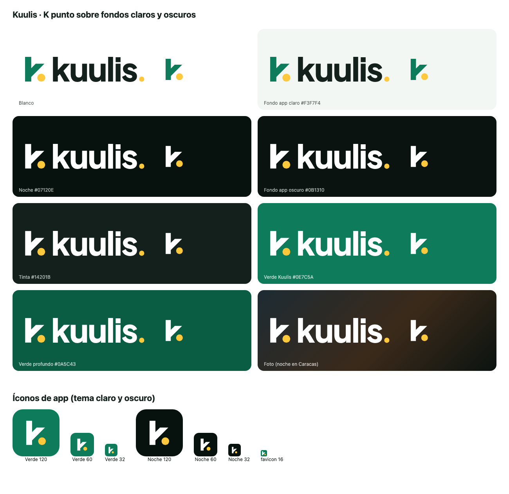

# Logo de Kuulis: «K punto»

**Estado:** aprobado por Carlos (2026-10-24) y aplicado el mismo día en la app (íconos, splash y `Wordmark`), la web
(favicon, manifiesto, cabecera, pie, tarjetas y las imágenes `og/`), el panel (favicon, barra lateral y login), los
correos y el recibo del viaje. Ver §9 y §12.

## 1. La idea
El punto final es la pierna de la k: **«kuulis.» y «y punto» en una sola letra.** El punto amarillo ya era el rasgo
propio de la marca (el final del logotipo, de cada titular y el destino en el mapa, ver
[`docs/website-redesign/02`](../../../docs/website-redesign/02-creative-direction-and-visual-system.md) §1). El símbolo
lo convierte en parte de la letra: la k llega a su destino.



## 2. Versiones
| Versión | Archivo | Cuándo |
| --- | --- | --- |
| **Horizontal** (principal) | `svg/kuulis-horizontal.svg` | Web, documentos, firmas, todo lo que tenga ancho |
| Vertical | `svg/kuulis-vertical.svg` | Formatos cuadrados o verticales: carteles, chaqueta, cierre de video |
| Símbolo | `svg/kuulis-simbolo.svg` | Ícono de app, avatar de redes, sello, espacios pequeños |
| Símbolo, corte pequeño | `svg/kuulis-simbolo-pequeno.svg` | Solo de 16 a 32 px (favicon, notificaciones): trazos más gruesos y punto más grande |
| Logotipo | `svg/kuulis-logotipo.svg` | Cuando el símbolo ya está cerca (por ejemplo, junto al ícono de la app) |

Cada versión existe en cinco colores (sufijo del archivo):

| Sufijo | Colores | Fondo |
| --- | --- | --- |
| *(ninguno)* | k verde, letras tinta, puntos amarillos | Blanco, `#F3F7F4` y otros fondos claros |
| `-negativo` | k y letras blancas, puntos amarillos | Noche, fondo oscuro de la app, tinta, verde, fotos oscuras |
| `-negro` | Todo negro | Impresión a un color, sellos, fax, documentos legales |
| `-blanco` | Todo blanco | Grabado, bordado o serigrafía a un color sobre fondo oscuro |
| `-verde` | Todo verde Kuulis | Impresión a un color sobre claro cuando sí hay tinta de marca |

Las versiones blancas son 0,75 unidades más finas que las demás: lo claro sobre oscuro se ve más grueso.
PNG transparentes de todas en `png/` (horizontal y logotipo a 2000 px de ancho, el resto a 1024 o 1200 px).

## 3. Construcción
Retícula de 256 unidades. Asta de 48 de ancho y 192 de alto (la altura de la «l» del logotipo). El brazo va a 45°, con
el mismo grueso que el asta, y termina justo en la altura de la x del logotipo. El punto mide 62 de diámetro y baja
1 unidad por debajo de la línea base (corrección óptica: lo redondo se ve más corto). En el logotipo, el punto también
es un círculo: el punto de Plus Jakarta Sans es cuadrado, y el punto de Kuulis siempre es redondo.

## 4. Área de respeto
Alrededor del logo queda libre, por todos los lados, **el diámetro del punto del símbolo** (un tercio de la altura del
símbolo). Esa distancia crece y se encoge con el logo. En el logotipo solo, se usa la altura de la «u».

## 5. Tamaño mínimo
| Versión | Pantalla | Impresión |
| --- | --- | --- |
| Horizontal | 96 px de ancho | 25 mm de ancho |
| Vertical | 64 px de ancho | 18 mm de ancho |
| Símbolo | 24 px; de 16 a 32 px, el **corte pequeño** | 6 mm |

## 6. Color
| Nombre | HEX | RGB | CMYK (conversión directa) | Pantone (sugerido) |
| --- | --- | --- | --- | --- |
| Verde Kuulis | `#0E7C5A` | 14 124 90 | 89 0 27 51 | 3415 C |
| Amarillo del punto | `#FFC83D` | 255 200 61 | 0 22 76 0 | 123 C |
| Tinta | `#14201B` | 20 32 27 | 38 0 15 87 | Black 6 C |
| Noche | `#07120E` | 7 18 14 | 61 0 22 93 | Black 6 C |

Los CMYK salen de una conversión directa y los Pantone son el tono más cercano conocido. Antes de imprimir, hay que
pedir una prueba de color o compararlos con una guía Pantone física.

Contraste: verde sobre blanco 5,2:1; blanco sobre noche 19:1; amarillo sobre verde 3,4:1; amarillo sobre noche 12:1.
El amarillo sobre blanco da 1,6:1. Dentro del logo está bien, porque el punto acompaña a la k. **Nunca** se pone el
punto amarillo solo, ni texto amarillo, sobre un fondo claro (regla de [`visual.md`](../visual.md)).

**Fondos aprobados:** blanco y claros → versión a color. Noche, fondo oscuro de la app, tinta, verde, verde profundo y
fotos oscuras → `-negativo`. Fotos claras o con mucho detalle → el logo sobre una placa verde o noche.

## 7. Tipografía
El logotipo es **Plus Jakarta Sans ExtraBold** convertido en curvas, la misma letra del sitio y de la app (licencia
SIL OFL). Nunca se escribe «kuulis.» con el teclado para hacer el logo: se usa el archivo.

## 8. Lo que no se hace
- Estirar, aplastar, girar o inclinar el logo.
- Cambiar los colores fuera de esta tabla, o poner la k amarilla y el punto verde.
- Separar el punto de la k, moverlo o cambiarle el tamaño. El punto es la pierna de la letra.
- Sombras, contornos, degradados, brillos o efectos.
- Usar la versión a color sobre fondos oscuros (el verde sobre noche se pierde: 3,7:1).
- Reordenar el símbolo y el logotipo, o cambiar su distancia.
- Usar el corte pequeño en tamaños grandes, o el símbolo normal por debajo de 24 px.

## 9. Archivos listos para usar
| Carpeta | Contenido | Reemplaza |
| --- | --- | --- |
| `app/` | `icon.png` (1024), `android-icon-foreground.png` y `android-icon-background.png` (512), `android-icon-monochrome.png` (432), `splash-icon.png` (1024), `favicon.png` (48) | Los archivos con el mismo nombre en `mobile/assets/`. Además, en `mobile/app.config.ts`, `adaptiveIcon.backgroundColor` pasa a `#0E7C5A` |
| `web/` | `favicon.svg`, `favicon.ico`, `favicon-16/32/48.png`, `apple-touch-icon.png`, `icon-192.png`, `icon-512.png`, `maskable-512.png`, `site.webmanifest`, `head-snippet.html` | `web/public/favicon.svg` e `icon-192.png`, más las etiquetas del `<head>` |
| `svg/kuulis-icono-app*.svg` | Ícono en verde y en noche | Avatares de redes y materiales |

El favicon es una placa verde con el corte pequeño en blanco y el punto amarillo, como el actual, para que se vea en
pestañas claras y oscuras.

## 10. Pruebas
- `pruebas/conceptos.png`: los tres conceptos de la ronda 1 (K punto, Doble U, La Silla).
- `pruebas/hoja-de-pruebas.html`: escalera de tamaños, prueba de píxel a 16/32/48 px, un color, negativo, desenfoque,
  espejo, contextos y el estante con la competencia.
- `pruebas/estante-competencia.png`: el ícono frente a Uber, Bolt, inDrive, Yummy y Ridery. Esos íconos no son sus
  logos reales: son aproximaciones con el color de cada marca.
- `pruebas/fondos.png`: todas las combinaciones de fondo aprobadas.
- `presentacion/presentacion.html` (y `laminas/`): presentación con aplicaciones (ícono, cartel, franela, redes, web,
  calcomanía).

Pendiente: una búsqueda de marca registrada en el SAPI (Venezuela) y en las bases internacionales antes de registrar
el logo. Nadie puede garantizar que esté libre sin esa búsqueda.

## 11. Regenerar
Todo sale de `fuente/` (Python 3 + `fonttools`):
```bash
cd marketing/brand/logo/fuente
pip install fonttools
python build_logo.py ../../../../api/apps/rides/assets/PlusJakartaSans_800ExtraBold.ttf ..   # svg/
python export_assets.py .. <ruta a logo-design/scripts>                                       # png/, web/, app/
python fondos.py .. ../pruebas/fondos.html
```
`export_assets.py` usa `render_png.py` y `export_variants.py` del skill de diseño de logos (necesita Chrome u otro
renderizador de SVG).

## 12. Dónde está aplicado
| Lugar | Archivo |
| --- | --- |
| App: ícono, ícono adaptable (fondo `#0E7C5A`), monocromo, splash, favicon web | `mobile/assets/`, `mobile/app.config.ts` |
| App: logo en pantallas (cabecera verde, inicio del pasajero, perfil, «Acerca de») | `Wordmark` en `mobile/src/components/ui.tsx`, trazos en `mobile/src/components/logo.ts` |
| Web: favicon, `.ico`, apple-touch, íconos 192/512, maskable, manifiesto | `web/public/`, `<head>` en `web/nuxt.config.ts` |
| Web: cabecera, pie y tarjetas de enlaces | `web/app/components/KuulisWordmark.vue` (`tone="negative"` sobre oscuro) |
| Web: imágenes para compartir (og:image) | `web/scripts/og-images.mjs` → `web/public/og/` (`pnpm og`) |
| Web: archivos para terceros | `web/public/brand/` (SVG y el PNG de los correos) |
| Panel: favicon, barra lateral (símbolo al plegarla), pantallas de acceso | `admin/public/`, `admin/app/components/KuulisLogo.vue`, `admin/app/layouts/` |
| Correos | `api/apps/notifications/emails.py` (PNG servido por la web en `/brand/kuulis-email.png`) |
| Recibo del viaje (imagen) | `api/apps/rides/receipt.py`, `api/apps/rides/assets/kuulis-horizontal-negativo.png` |

Las capturas de la app que muestra la web (`web/public/img/app/`) todavía tienen el logotipo anterior: se cambian
cuando se tomen capturas nuevas de la app.
